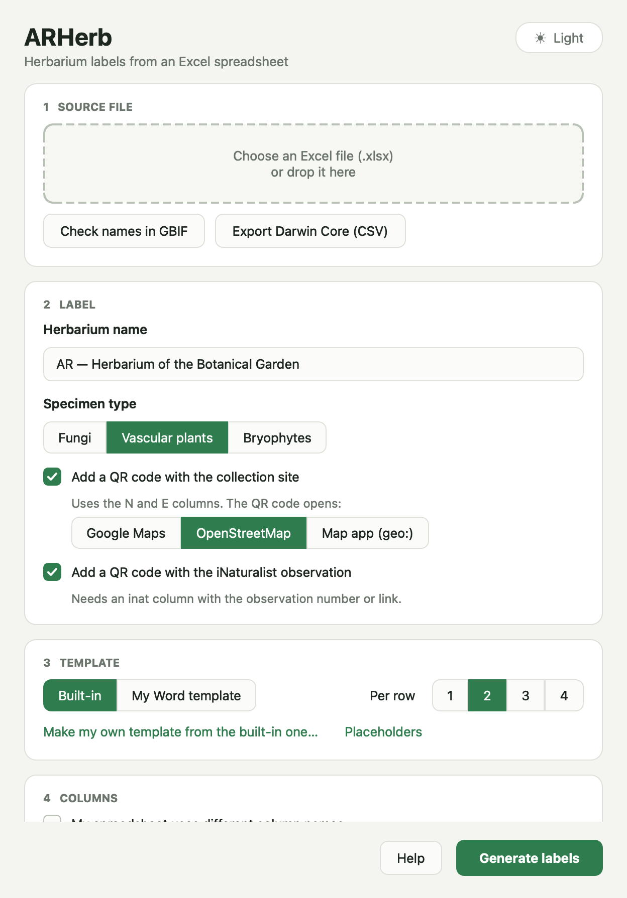
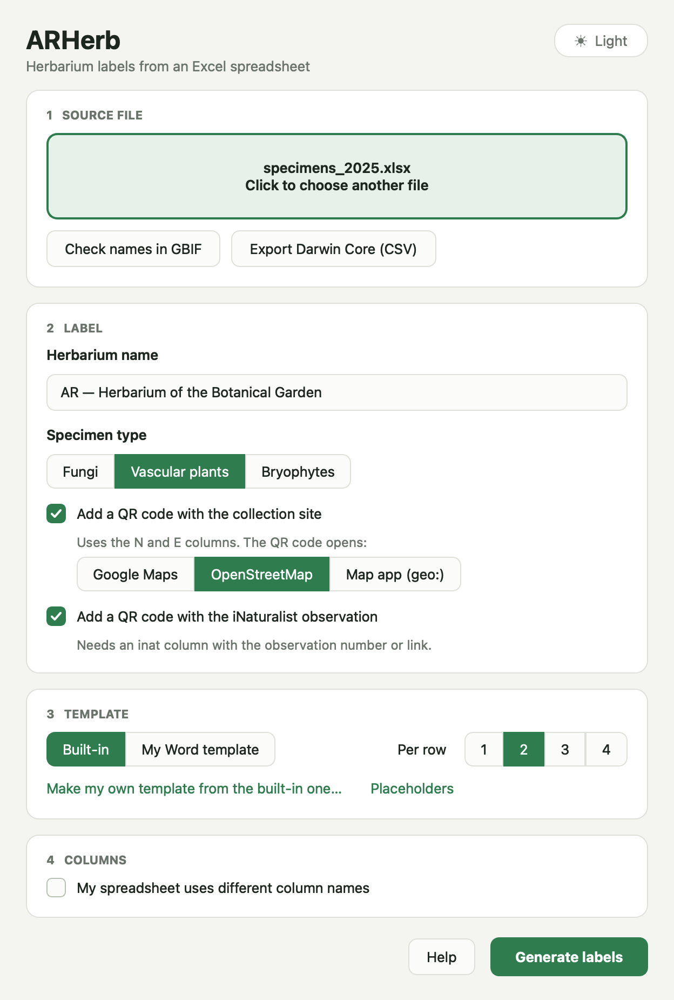
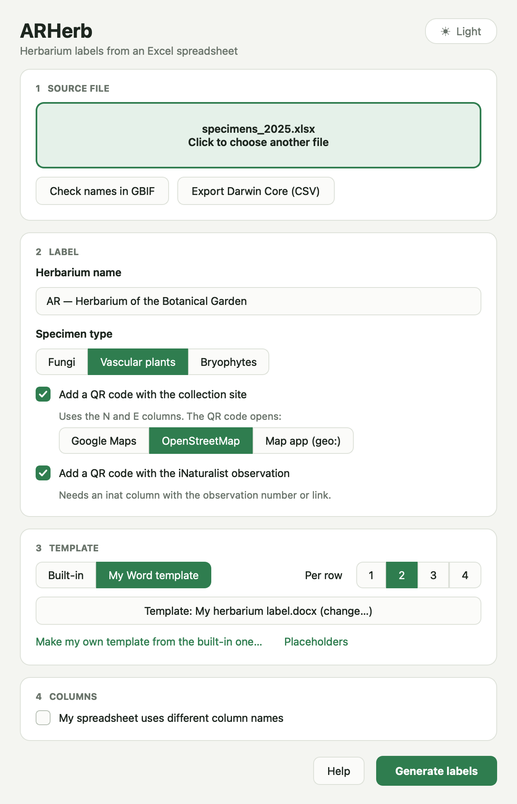
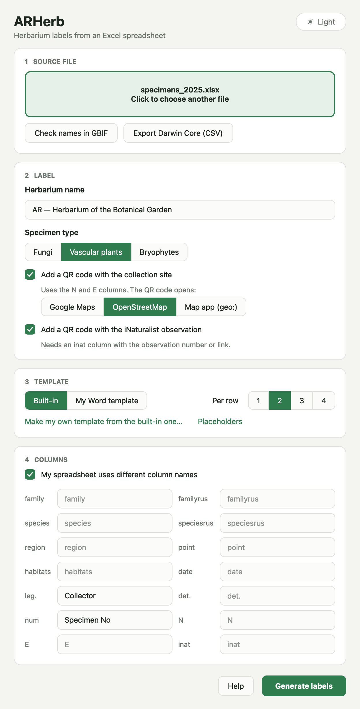
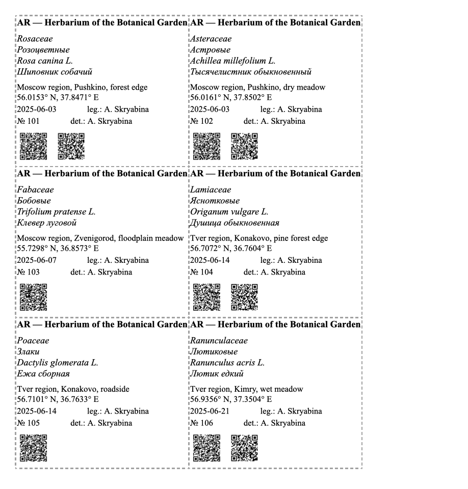
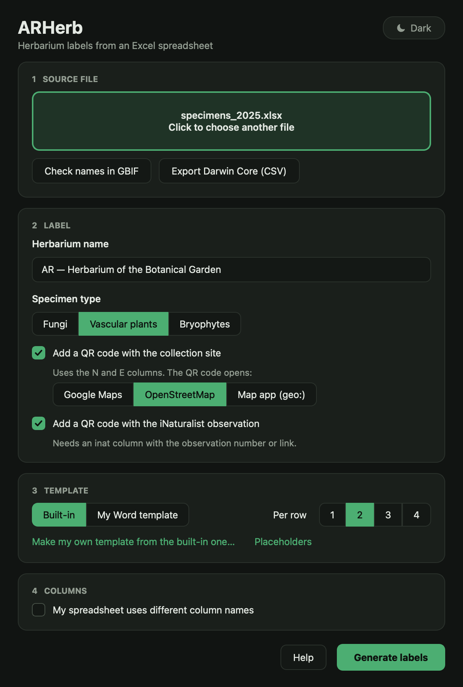
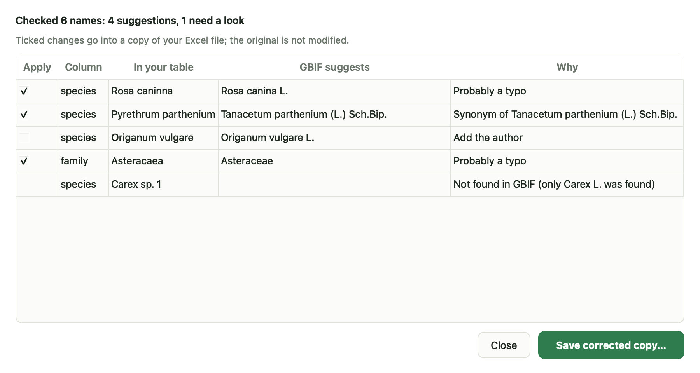
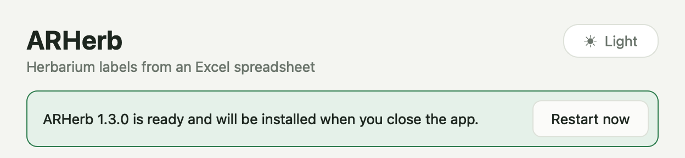

# ARHerb

[English](#english) · [Русский](#русский)

## English

ARHerb is a desktop application that automates the creation of labels for herbarium specimens. It turns an Excel spreadsheet into a ready-to-print Word document with QR codes, checks scientific names against GBIF and exports data in Darwin Core.

### Features

- **Print-ready Word documents** (.docx), 1–4 labels per row; a label is never split across pages.
- **Your own label design**: make the template in Word with placeholders like `{species}` or `{qr}`, or use the built-in one.
- **QR codes** with the collection site on Google Maps, OpenStreetMap or the phone's map app (`geo:`), plus an optional QR code with the iNaturalist observation.
- **GBIF name check**: finds typos and synonyms in scientific names and suggests the accepted name with its author.
- **Darwin Core export** to publish your collection to GBIF; Darwin Core column names are also understood on input.
- **Specimen types**: fungi, bryophytes and vascular plants (vascular plants can also show Russian family and species names).
- **Custom column mapping** if your spreadsheet uses different column names. Missing columns are reported before the document is generated.
- **Light and dark themes** and **automatic updates** from GitHub Releases.

### Download

Ready-made builds are on the [Releases](https://github.com/sshskrbna/ARHerb/releases) page.

- **Windows**: download `ARHerb-windows.exe` and run it.
- **macOS** (Apple Silicon, M1 and newer): download `ARHerb-macos-arm64.zip`, unzip it and move `ARHerb.app` to Applications. The app is not signed by Apple, so on first launch macOS will block it: open **System Settings → Privacy & Security** and click **Open Anyway**.
- **Linux** (x86_64): download `ARHerb-linux-x86_64.tar.gz`, then:

  ```bash
  tar -xzf ARHerb-linux-x86_64.tar.gz
  ./ARHerb
  ```

  If it fails with an error about the `xcb` plugin, install `libxcb-cursor0` (Debian/Ubuntu: `sudo apt install libxcb-cursor0`).

### How to use

**1. Choose the Excel file.** Click the dashed area or drag the `.xlsx` file into the window. Enter the herbarium name: it is printed in bold at the top of every label.



**2. Choose the specimen type and the QR codes.** For vascular plants the Russian family and species names (`familyrus`, `speciesrus`) are added to the label. The collection site QR code can open Google Maps, OpenStreetMap or the map app on the phone (`geo:`). Tick the iNaturalist option to add a second QR code with the observation: it needs an `inat` column with the observation number or link.



**3. Choose the label design** (see [Label templates](#label-templates)) and how many labels go in a row.



**4. If your columns are named differently**, tick *My spreadsheet uses different column names* and type your names next to the standard ones. Leave a field empty to keep the default name. See [Excel format](#excel-format) for the full list.



**5. Click _Generate labels_.** The Word document is saved next to the Excel file as `<name>_output.docx`, ready to print and cut along the dashed lines.



The theme button in the top right corner switches between *Auto* (same as the system), *Light* and *Dark*.



### Label templates

A template is an ordinary Word document with the design of **one** label. ARHerb makes a copy of it for every row of the spreadsheet, replaces the placeholders with data and lays the labels out in a grid.

1. Click **Make my own template from the built-in one…** and save the file: it opens in Word.
2. Change fonts, sizes and layout, move or delete lines, add your logo or a frame. Keep the words in curly braces where the data should go.
3. Save it. ARHerb switches to *My Word template* and uses it from then on.

| Placeholder | Replaced with |
|---|---|
| `{herbarium}` | Herbarium name entered in the app |
| `{family}`, `{species}` | Family and species |
| `{familyrus}`, `{speciesrus}` | Russian names (vascular plants) |
| `{region}`, `{point}`, `{habitats}` | Region, locality, habitat |
| `{location}` | Region, locality and habitat joined with commas |
| `{date}`, `{leg}`, `{det}`, `{num}` | Date, collector, identified by, specimen number |
| `{lat}`, `{lon}`, `{coords}` | Coordinates; `{coords}` looks like `56.0153° N, 37.8471° E` |
| `{inat}` | Link to the iNaturalist observation |
| `{qr}`, `{inat_qr}` | QR codes: collection site and iNaturalist observation |

Any other column of your spreadsheet works too, by its name: `{Altitude}`, `{Notes}`… Capital letters don't matter (`{Species}` works). A placeholder takes the formatting of its first letter, so make `{species}` italic and the species will be italic.

Empty values tidy up after themselves:

- a line whose placeholders are all empty is removed, captions included: `Alt.: {Altitude}` disappears when there is no altitude;
- empty brackets go too: `{family} ({familyrus})` prints just the family when there is no Russian name;
- to keep a line for handwriting, add two or more underscores: `Det.: {det} ______`.

ARHerb warns before generating if the template has placeholders it does not know, such as a misspelled `{speceis}`.

### GBIF: name check and Darwin Core

**Check names in GBIF** looks up every distinct name of the `species` column in the [GBIF taxonomy](https://www.gbif.org/species/search) and lists:

- typos (`Rosa caninna` → `Rosa canina L.`) and synonyms (`Pyrethrum parthenium` → `Tanacetum parthenium (L.) Sch.Bip.`), ticked by default;
- missing or different authors and alternative family names (`Compositae` → `Asteraceae`), not ticked;
- names GBIF does not know, and species whose family in the table differs from GBIF.



**Save corrected copy** writes the ticked changes into a copy of your Excel file (formatting is kept, the original is not touched) and selects the copy.

**Export Darwin Core (CSV)** saves the table with [Darwin Core](https://dwc.tdwg.org/terms/) columns (`scientificName`, `eventDate`, `recordedBy`, `decimalLatitude`…), ready to upload to a GBIF publishing tool such as the IPT. Enter the herbarium acronym as the herbarium name: it becomes `institutionCode` and, with the specimen number, `occurrenceID`.

### Updates

The app checks GitHub Releases on every start. When a new version is out, it is downloaded in the background and installed when you close ARHerb. Click **Restart now** to install it right away.



Automatic updates work for the downloaded builds. On macOS the app must be in the Applications folder (or any folder you can write to), not launched straight from Downloads. If ARHerb cannot update itself, it shows a link to the release page instead. Versions up to 1.1.3 do not have this feature yet, so download the new version manually once.

### Run from source

Requires Python 3.10+.

```bash
git clone https://github.com/sshskrbna/ARHerb.git
cd ARHerb
pip install -r requirements.txt
python main.py
```

### Excel format

The first sheet is read; the first row holds column names. Default names:

| Column | Content |
|---|---|
| `family` | Family (Latin) |
| `familyrus` | Family (Russian), vascular plants only |
| `species` | Species (Latin) |
| `speciesrus` | Species (Russian), vascular plants only |
| `region` | Region |
| `point` | Locality |
| `habitats` | Habitat |
| `date` | Collection date |
| `leg.` | Collector |
| `det.` | Identified by |
| `num` | Specimen number |
| `N` | Latitude, decimal degrees (`55.75` or `55,75`) |
| `E` | Longitude, decimal degrees |
| `inat` | iNaturalist observation number or link (optional) |

Darwin Core names work as well when the default column is absent: `scientificName`, `vernacularName`, `stateProvince`, `locality`, `habitat`, `eventDate`, `recordedBy`, `identifiedBy`, `catalogNumber`, `decimalLatitude`, `decimalLongitude`. Any other column can be printed through a [template](#label-templates).

Empty cells are allowed. The output is saved next to the source file as `<name>_output.docx`.

### Tech stack

Python, PyQt6, pandas + openpyxl, python-docx, qrcode + Pillow, GBIF API.

### Releasing

Bump `__version__` in `main.py`, commit, then push a tag with the same value:

```bash
git tag 1.2.0
git push origin 1.2.0
```

GitHub Actions builds Windows, macOS and Linux binaries and publishes them as a release; installed apps pick it up automatically.

### Contributing

Found a bug or have an idea? Please open an [Issue](https://github.com/sshskrbna/ARHerb/issues).

## Русский

ARHerb — десктопное приложение для автоматического создания этикеток гербарных образцов. Оно превращает Excel-таблицу в готовый к печати документ Word с QR-кодами, проверяет латинские названия по GBIF и экспортирует данные в Darwin Core.

### Возможности

- **Готовые к печати документы Word** (.docx), от 1 до 4 этикеток в ряд; этикетка не разрывается между страницами.
- **Свой дизайн этикетки**: шаблон делается в Word с метками вроде `{species}` или `{qr}`, либо используется встроенный.
- **QR-коды** с местом сбора в Google Maps, OpenStreetMap или в приложении карт на телефоне (`geo:`), а по желанию ещё и QR-код наблюдения в iNaturalist.
- **Проверка названий по GBIF**: находит опечатки и синонимы и предлагает принятое название с автором.
- **Экспорт в Darwin Core** для публикации коллекции в GBIF; колонки с названиями Darwin Core понимаются и на входе.
- **Типы образцов**: грибы, мохообразные и сосудистые растения (для сосудистых можно выводить русские названия семейства и вида).
- **Свои названия колонок**, если в таблице они отличаются от стандартных. Отсутствующие колонки показываются до генерации документа.
- **Светлая и тёмная темы** и **автоматические обновления** из GitHub Releases.

### Скачать

Готовые сборки лежат на странице [Releases](https://github.com/sshskrbna/ARHerb/releases).

- **Windows**: скачайте `ARHerb-windows.exe` и запустите.
- **macOS** (Apple Silicon, M1 и новее): скачайте `ARHerb-macos-arm64.zip`, распакуйте и перенесите `ARHerb.app` в «Программы». Приложение не подписано Apple, поэтому при первом запуске macOS его заблокирует: откройте **Системные настройки → Конфиденциальность и безопасность** и нажмите **Всё равно открыть**.
- **Linux** (x86_64): скачайте `ARHerb-linux-x86_64.tar.gz`, затем:

  ```bash
  tar -xzf ARHerb-linux-x86_64.tar.gz
  ./ARHerb
  ```

  Если появится ошибка про плагин `xcb`, установите `libxcb-cursor0` (Debian/Ubuntu: `sudo apt install libxcb-cursor0`).

### Как пользоваться

**1. Выберите Excel-файл.** Нажмите на область с пунктиром или перетащите `.xlsx` в окно. Введите название гербария: оно печатается жирным в шапке каждой этикетки.


**2. Выберите тип образцов и QR-коды.** Для сосудистых растений на этикетку добавляются русские названия семейства и вида (`familyrus`, `speciesrus`). QR-код места сбора может открывать Google Maps, OpenStreetMap или приложение карт на телефоне (`geo:`). Галочка iNaturalist добавляет второй QR-код со ссылкой на наблюдение. Для него нужна колонка `inat` с номером наблюдения или ссылкой на него.


**3. Выберите дизайн этикетки** (см. [Шаблоны этикеток](#шаблоны-этикеток)) и сколько этикеток ставить в ряд.


**4. Если колонки в таблице называются по-другому**, отметьте *My spreadsheet uses different column names* и впишите свои названия рядом со стандартными. Пустое поле означает стандартное название. Полный список колонок есть в разделе [Формат Excel](#формат-excel).


**5. Нажмите _Generate labels_.** Документ Word сохранится рядом с Excel-файлом как `<имя>_output.docx`: готово к печати и нарезке по пунктирным линиям.


Кнопка в правом верхнем углу переключает тему: *Auto* (как в системе), *Light* (светлая), *Dark* (тёмная).


### Шаблоны этикеток

Шаблон — обычный документ Word с дизайном **одной** этикетки. ARHerb копирует его для каждой строки таблицы, подставляет данные вместо меток и раскладывает этикетки сеткой.

1. Нажмите **Make my own template from the built-in one…** и сохраните файл: он откроется в Word.
2. Меняйте шрифты, размеры и расположение, переставляйте и удаляйте строки, добавьте логотип или рамку. Слова в фигурных скобках оставьте там, где должны стоять данные.
3. Сохраните файл. ARHerb переключится на *My Word template* и дальше будет использовать его.

| Метка | Что подставляется |
|---|---|
| `{herbarium}` | Название гербария из приложения |
| `{family}`, `{species}` | Семейство и вид |
| `{familyrus}`, `{speciesrus}` | Русские названия (сосудистые растения) |
| `{region}`, `{point}`, `{habitats}` | Регион, пункт сбора, местообитание |
| `{location}` | Регион, пункт и местообитание через запятую |
| `{date}`, `{leg}`, `{det}`, `{num}` | Дата, собрал, определил, номер образца |
| `{lat}`, `{lon}`, `{coords}` | Координаты; `{coords}` выглядит как `56.0153° N, 37.8471° E` |
| `{inat}` | Ссылка на наблюдение в iNaturalist |
| `{qr}`, `{inat_qr}` | QR-коды: место сбора и наблюдение iNaturalist |

Подходит и любая другая колонка вашей таблицы, по её названию: `{Altitude}`, `{Notes}`… Регистр букв не важен (`{Species}` тоже работает). Метка берёт оформление своей первой буквы: если сделать `{species}` курсивом, вид будет напечатан курсивом.

Пустые значения убираются аккуратно:

- строка, в которой все метки пустые, удаляется вместе с подписью: `Высота: {Altitude}` исчезнет, если высоты нет;
- пустые скобки тоже: `{family} ({familyrus})` напечатает только семейство, если нет русского названия;
- чтобы оставить строку для записи от руки, добавьте два или больше подчёркиваний: `Определил: {det} ______`.

Если в шаблоне есть незнакомые метки (например, `{speceis}` с опечаткой), ARHerb предупредит перед генерацией.

### GBIF: проверка названий и Darwin Core

**Check names in GBIF** сверяет каждое название из колонки `species` с [таксономией GBIF](https://www.gbif.org/species/search) и показывает:

- опечатки (`Rosa caninna` → `Rosa canina L.`) и синонимы (`Pyrethrum parthenium` → `Tanacetum parthenium (L.) Sch.Bip.`) — отмечены галочкой сразу;
- отсутствующего или другого автора и альтернативные названия семейств (`Compositae` → `Asteraceae`) — без галочки;
- названия, которых нет в GBIF, и виды, у которых семейство в таблице расходится с GBIF.


**Save corrected copy** записывает отмеченные исправления в копию Excel-файла. Оформление сохраняется, оригинал не меняется, а копия сразу становится выбранным файлом.

**Export Darwin Core (CSV)** сохраняет таблицу с колонками [Darwin Core](https://dwc.tdwg.org/terms/) (`scientificName`, `eventDate`, `recordedBy`, `decimalLatitude`…), готовую к загрузке в инструмент публикации GBIF, например IPT. В поле названия гербария введите его акроним: он станет `institutionCode`, а вместе с номером образца — `occurrenceID`.

### Обновления

При каждом запуске приложение проверяет GitHub Releases. Если вышла новая версия, она скачивается в фоне и устанавливается, когда вы закрываете ARHerb. Кнопка **Restart now** установит её сразу.


Автообновление работает в скачанных сборках. На macOS приложение должно лежать в «Программах» (или в любой папке, куда у вас есть права на запись), а не запускаться прямо из «Загрузок». Если ARHerb не может обновиться сам, он покажет ссылку на страницу релиза. В версиях до 1.1.3 включительно этой функции ещё нет, поэтому новую версию один раз нужно скачать вручную.

### Запуск из исходников

Нужен Python 3.10+.

```bash
git clone https://github.com/sshskrbna/ARHerb.git
cd ARHerb
pip install -r requirements.txt
python main.py
```

### Формат Excel

Читается первый лист, в первой строке — названия колонок. Названия по умолчанию:

| Колонка | Содержимое |
|---|---|
| `family` | Семейство (латынь) |
| `familyrus` | Семейство (рус.), только для сосудистых |
| `species` | Вид (латынь) |
| `speciesrus` | Вид (рус.), только для сосудистых |
| `region` | Регион |
| `point` | Пункт сбора |
| `habitats` | Местообитание |
| `date` | Дата сбора |
| `leg.` | Собрал |
| `det.` | Определил |
| `num` | Номер образца |
| `N` | Широта в десятичных градусах (`55.75` или `55,75`) |
| `E` | Долгота в десятичных градусах |
| `inat` | Номер или ссылка на наблюдение iNaturalist (необязательно) |

Если стандартной колонки нет, подходят и названия Darwin Core: `scientificName`, `vernacularName`, `stateProvince`, `locality`, `habitat`, `eventDate`, `recordedBy`, `identifiedBy`, `catalogNumber`, `decimalLatitude`, `decimalLongitude`. Любую другую колонку можно вывести через [шаблон](#шаблоны-этикеток).

Пустые ячейки допускаются. Результат сохраняется рядом с исходным файлом как `<имя>_output.docx`.

### Технологии

Python, PyQt6, pandas + openpyxl, python-docx, qrcode + Pillow, GBIF API.

### Выпуск новой версии

Поднимите `__version__` в `main.py`, закоммитьте и запушьте тег с тем же номером:

```bash
git tag 1.2.0
git push origin 1.2.0
```

GitHub Actions соберёт версии для Windows, macOS и Linux и опубликует релиз, а установленные приложения обновятся сами.

### Участие в разработке

Нашли ошибку или есть идея? Создайте [Issue](https://github.com/sshskrbna/ARHerb/issues).
