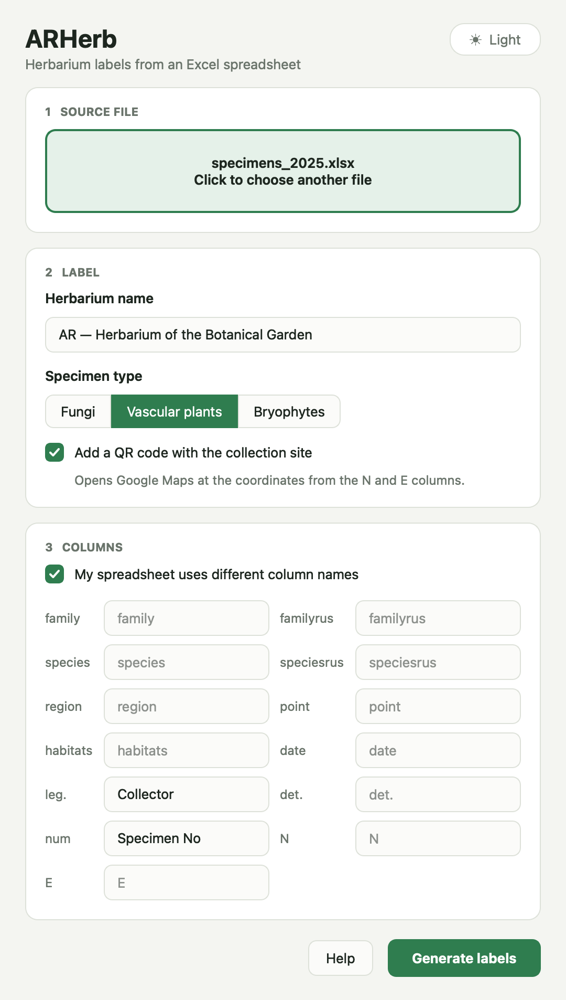
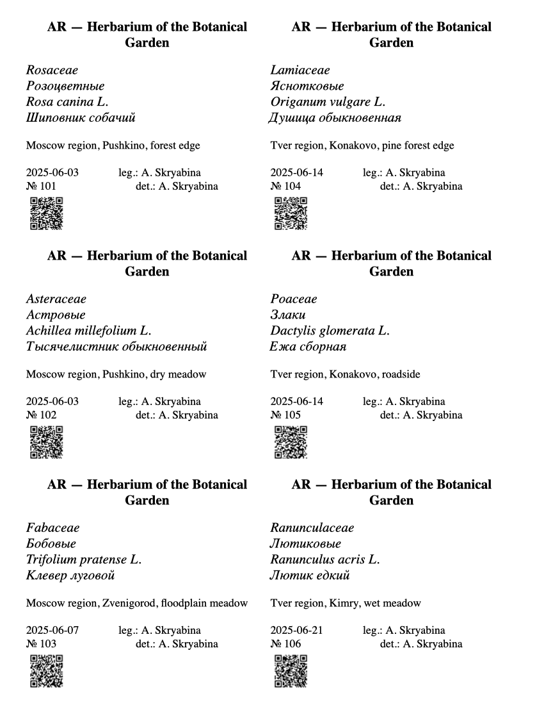

# ARHerb

[English](#english) · [Русский](#русский)

## English

ARHerb is a desktop application that automates the creation of labels for herbarium specimens. It turns an Excel spreadsheet into a ready-to-print Word document, optionally with QR codes linking to the collection site on Google Maps.

### Features

- **Simple GUI** built with PyQt6.
- **Print-ready Word documents** (.docx), two labels per row; a label is never split across pages.
- **QR codes** with a Google Maps link built from the latitude/longitude columns.
- **Specimen types**: fungi, bryophytes and vascular plants (vascular plants can also show Russian family and species names).
- **Custom column mapping** if your spreadsheet uses different column names. Missing columns are reported before the document is generated.
- **Light and dark themes**, following the system by default.
- **Automatic updates** from GitHub Releases.

### Download

Ready-made builds are on the [Releases](https://github.com/sshskrbna/ARHerb/releases) page.

- **Windows**: download `ARHerb-windows.exe` and run it.
- **macOS** (Apple Silicon, M1 and newer): download `ARHerb-macos-arm64.zip`, unzip it and move `ARHerb.app` to Applications. The app is not signed by Apple, so on first launch macOS will block it: open **System Settings → Privacy & Security** and click **Open Anyway**.
- **Linux** (x86_64): download `ARHerb-linux-x86_64.tar.gz`, then:

  ```bash
  tar -xzf ARHerb-linux-x86_64.tar.gz
  ./ARHerb
  ```

  If it fails with an error about the `xcb` plugin, install `libxcb-cursor0` (Debian/Ubuntu: `sudo apt install libxcb-cursor0`).

### How to use

**1. Choose the Excel file.** Click the dashed area or drag the `.xlsx` file into the window. Enter the herbarium name: it is printed in bold at the top of every label.


**2. Choose the specimen type** and, if you want, turn on QR codes. For vascular plants the Russian family and species names (`familyrus`, `speciesrus`) are added to the label.


**3. If your columns are named differently**, tick *My spreadsheet uses different column names* and type your names next to the standard ones. Leave a field empty to keep the default name. See [Excel format](#excel-format) for the full list.



**4. Click _Generate labels_.** The Word document is saved next to the Excel file as `<name>_output.docx`, two labels per row, ready to print and cut.



The theme button in the top right corner switches between *Auto* (same as the system), *Light* and *Dark*.


### Updates

The app checks GitHub Releases on every start. When a new version is out, it is downloaded in the background and installed when you close ARHerb. Click **Restart now** to install it right away.


Automatic updates work for the downloaded builds. On macOS the app must be in the Applications folder (or any folder you can write to), not launched straight from Downloads. If ARHerb cannot update itself, it shows a link to the release page instead. Versions up to 1.1.3 do not have this feature yet, so download the new version manually once.

### Run from source

Requires Python 3.10+.

```bash
git clone https://github.com/sshskrbna/ARHerb.git
cd ARHerb
pip install -r requirements.txt
python main.py
```

### Excel format

The first sheet is read; the first row holds column names. Default names:

| Column | Content |
|---|---|
| `family` | Family (Latin) |
| `familyrus` | Family (Russian), vascular plants only |
| `species` | Species (Latin) |
| `speciesrus` | Species (Russian), vascular plants only |
| `region` | Region |
| `point` | Locality |
| `habitats` | Habitat |
| `date` | Collection date |
| `leg.` | Collector |
| `det.` | Identified by |
| `num` | Specimen number |
| `N` | Latitude, decimal degrees (`55.75` or `55,75`) |
| `E` | Longitude, decimal degrees |

Empty cells are allowed. The output is saved next to the source file as `<name>_output.docx`.

### Tech stack

Python, PyQt6, pandas + openpyxl, python-docx, qrcode + Pillow.

### Releasing

Bump `__version__` in `main.py`, commit, then push a tag with the same value:

```bash
git tag 1.2.0
git push origin 1.2.0
```

GitHub Actions builds Windows, macOS and Linux binaries and publishes them as a release; installed apps pick it up automatically.

### Contributing

Found a bug or have an idea? Please open an [Issue](https://github.com/sshskrbna/ARHerb/issues).

## Русский

ARHerb — десктопное приложение для автоматического создания этикеток гербарных образцов. Оно превращает Excel-таблицу в готовый к печати документ Word, при желании с QR-кодами, ведущими на место сбора в Google Maps.

### Возможности

- **Простой интерфейс** на PyQt6.
- **Готовые к печати документы Word** (.docx), по две этикетки в ряд; этикетка не разрывается между страницами.
- **QR-коды** со ссылкой на Google Maps по колонкам широты и долготы.
- **Типы образцов**: грибы, мохообразные и сосудистые растения (для сосудистых можно выводить русские названия семейства и вида).
- **Свои названия колонок**, если в таблице они отличаются от стандартных. Отсутствующие колонки показываются до генерации документа.
- **Светлая и тёмная темы**, по умолчанию как в системе.
- **Автоматические обновления** из GitHub Releases.

### Скачать

Готовые сборки лежат на странице [Releases](https://github.com/sshskrbna/ARHerb/releases).

- **Windows**: скачайте `ARHerb-windows.exe` и запустите.
- **macOS** (Apple Silicon, M1 и новее): скачайте `ARHerb-macos-arm64.zip`, распакуйте и перенесите `ARHerb.app` в «Программы». Приложение не подписано Apple, поэтому при первом запуске macOS его заблокирует: откройте **Системные настройки → Конфиденциальность и безопасность** и нажмите **Всё равно открыть**.
- **Linux** (x86_64): скачайте `ARHerb-linux-x86_64.tar.gz`, затем:

  ```bash
  tar -xzf ARHerb-linux-x86_64.tar.gz
  ./ARHerb
  ```

  Если появится ошибка про плагин `xcb`, установите `libxcb-cursor0` (Debian/Ubuntu: `sudo apt install libxcb-cursor0`).

### Как пользоваться

**1. Выберите Excel-файл.** Нажмите на область с пунктиром или перетащите `.xlsx` в окно. Введите название гербария: оно печатается жирным в шапке каждой этикетки.


**2. Выберите тип образцов** и при желании включите QR-коды. Для сосудистых растений на этикетку добавляются русские названия семейства и вида (`familyrus`, `speciesrus`).


**3. Если колонки в таблице называются по-другому**, отметьте *My spreadsheet uses different column names* и впишите свои названия рядом со стандартными. Пустое поле означает стандартное название. Полный список колонок есть в разделе [Формат Excel](#формат-excel).


**4. Нажмите _Generate labels_.** Документ Word сохранится рядом с Excel-файлом как `<имя>_output.docx`: по две этикетки в ряд, готово к печати и нарезке.


Кнопка в правом верхнем углу переключает тему: *Auto* (как в системе), *Light* (светлая), *Dark* (тёмная).


### Обновления

При каждом запуске приложение проверяет GitHub Releases. Если вышла новая версия, она скачивается в фоне и устанавливается, когда вы закрываете ARHerb. Кнопка **Restart now** установит её сразу.


Автообновление работает в скачанных сборках. На macOS приложение должно лежать в «Программах» (или в любой папке, куда у вас есть права на запись), а не запускаться прямо из «Загрузок». Если ARHerb не может обновиться сам, он покажет ссылку на страницу релиза. В версиях до 1.1.3 включительно этой функции ещё нет, поэтому новую версию один раз нужно скачать вручную.

### Запуск из исходников

Нужен Python 3.10+.

```bash
git clone https://github.com/sshskrbna/ARHerb.git
cd ARHerb
pip install -r requirements.txt
python main.py
```

### Формат Excel

Читается первый лист, в первой строке — названия колонок. Названия по умолчанию:

| Колонка | Содержимое |
|---|---|
| `family` | Семейство (латынь) |
| `familyrus` | Семейство (рус.), только для сосудистых |
| `species` | Вид (латынь) |
| `speciesrus` | Вид (рус.), только для сосудистых |
| `region` | Регион |
| `point` | Пункт сбора |
| `habitats` | Местообитание |
| `date` | Дата сбора |
| `leg.` | Собрал |
| `det.` | Определил |
| `num` | Номер образца |
| `N` | Широта в десятичных градусах (`55.75` или `55,75`) |
| `E` | Долгота в десятичных градусах |

Пустые ячейки допускаются. Результат сохраняется рядом с исходным файлом как `<имя>_output.docx`.

### Технологии

Python, PyQt6, pandas + openpyxl, python-docx, qrcode + Pillow.

### Выпуск новой версии

Поднимите `__version__` в `main.py`, закоммитьте и запушьте тег с тем же номером:

```bash
git tag 1.2.0
git push origin 1.2.0
```

GitHub Actions соберёт версии для Windows, macOS и Linux и опубликует релиз, а установленные приложения обновятся сами.

### Участие в разработке

Нашли ошибку или есть идея? Создайте [Issue](https://github.com/sshskrbna/ARHerb/issues).
